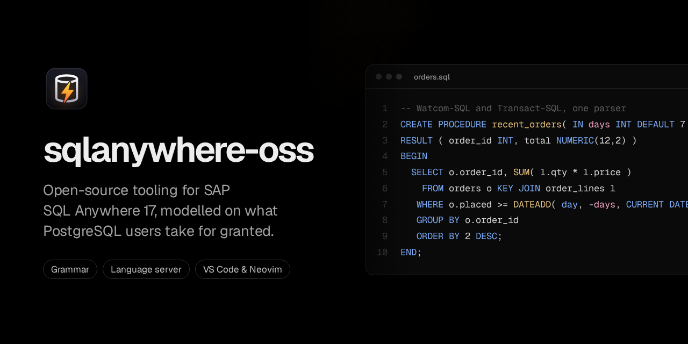

<h3 align="center">
   
  
  sqlanywhere-oss
  
</h3>

<h6 align="center">
  <a href="https://github.com/sqlanywhere-oss/sqlanywhere-grammar">Grammar</a>
  ·
  <a href="https://github.com/orgs/sqlanywhere-oss/repositories">Repositories</a>
</h6>

&nbsp;

  Open-source tooling for SAP SQL Anywhere 17, built in Rust on one parser that reads Watcom-SQL and Transact-SQL
  the way the engine does: a grammar, a language server, a formatter and a linter, with editor support for VS Code
  and Neovim.

&nbsp;

  

  Unofficial; not affiliated with or endorsed by SAP SE. SAP and SQL Anywhere are trademarks of SAP SE.

