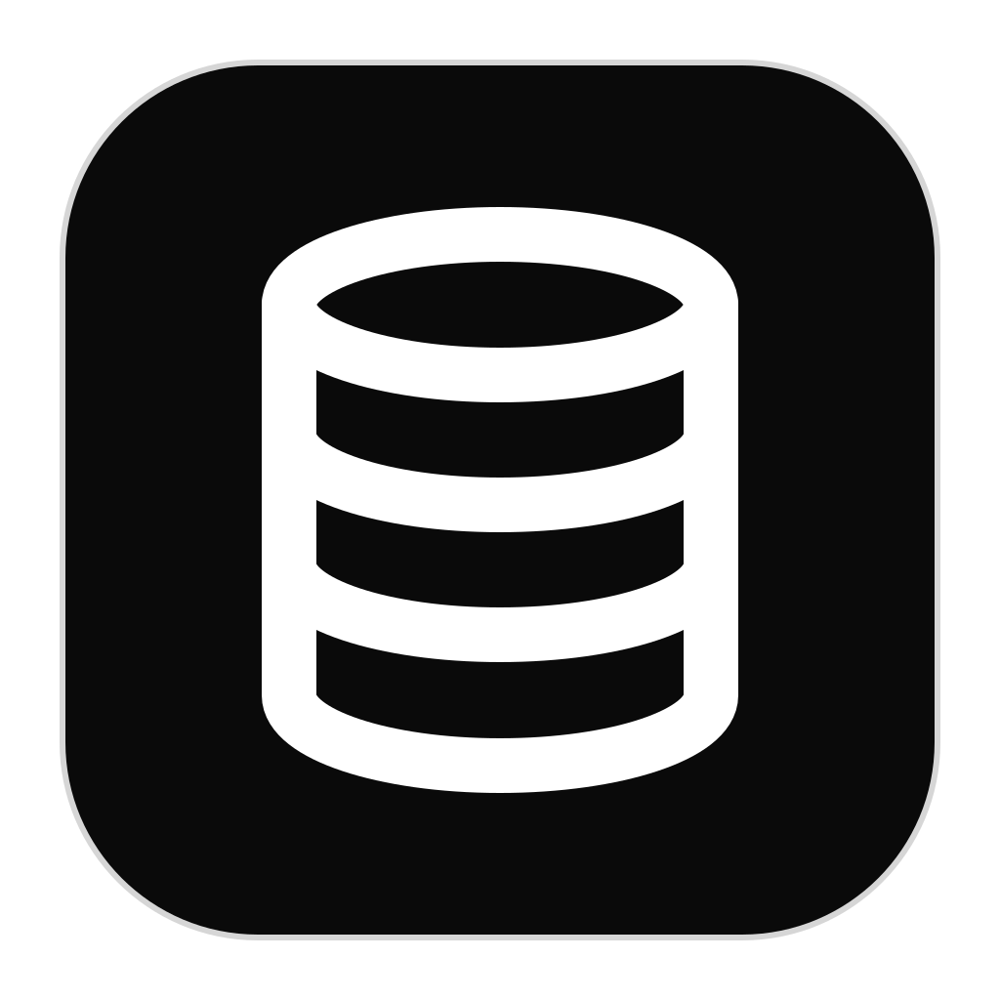

# sqlanywhere-oss
##### Open-source tooling for SAP SQL Anywhere 17

PostgreSQL users take a lot for granted: an exact parser anyone can embed, formatters, linters, language servers,
debuggers in the editor, schema as code, a good console. SQL Anywhere 17 has almost none of it. This organization builds
that tooling, in Rust, following PostgreSQL's tools wherever there is a counterpart.

Everything stands on one parser that reads SQL the way the engine does, Watcom-SQL and Transact-SQL alike, checked
statement by statement against a live engine rather than against the manuals.

## Projects

| Repository | What it is | Status |
|---|---|---|
| [sqlanywhere-grammar](https://github.com/sqlanywhere-oss/sqlanywhere-grammar) | The grammar (grmtools), a lossless lexer, a parser that behaves like the engine's, and the conformance suite; later `libsqla_query`, the counterpart of `libpg_query` | In progress |
| sqlanywhere-tools | `sqla`: the command line, language server, debug adapter, formatter, linter and MCP server | Planned |
| vscode-sqlanywhere | The VS Code extension | Planned |
| sqlanywhere.nvim | The Neovim plugin | Planned |

## Principles

- **Follow PostgreSQL.** Where a PostgreSQL tool has a counterpart here, we copy its shape, names and conventions.
- **Watcom-SQL and Transact-SQL are equal.** Every feature handles both, and every test corpus has both.
- **VS Code and Neovim are equal.** Editor features ship in both in the same release.
- **Windows, Linux and macOS** are all built and tested in CI.
- **Nothing from SAP is redistributed**: not the engine, not the manuals, not statements copied from them.

## Legal

This is an unofficial community project, not affiliated with or endorsed by SAP SE. SAP and SQL Anywhere are trademarks
of SAP SE.
